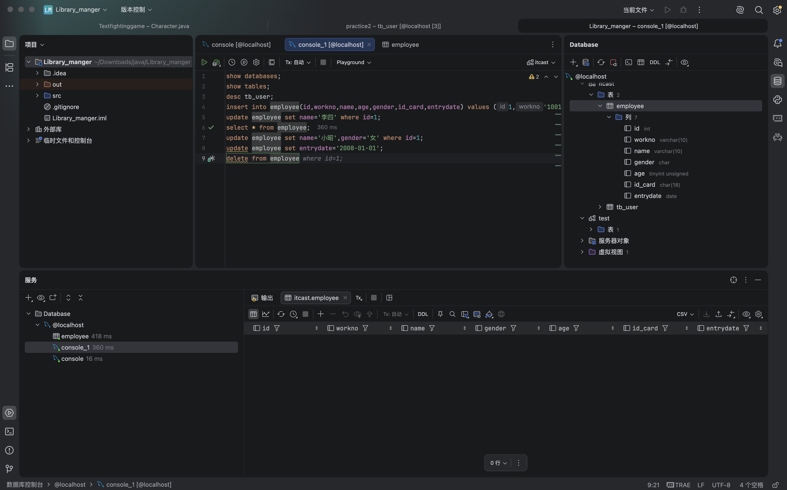

# 每日笔记

<!-- 复制本文件到当天文件夹，改名为 note.md -->

---

# 10-30

## 今天学了/做了什么

-
最近这两天我把DML学完了，下载SQL的图形化界面的时候，不得不再次感慨AI的伟大，我是直接在IDEA里面用的这个图形化界面一个插件Database Tool and SQL,用这个需要IDEA的ultimate版本，我可以学生认证对吧，但是我不会操作流程，然后我就把我的学校之类的相关信息发给dsh，他直接都能找到我们学校的电子邮箱地址，大大的提高了我的效率，帮我弄好了学生认证。 
增删改：
<增>：insert into 表名(字段1，字段2) values(值1，值2)-注意有对应关系;<改>：update 表名 set 字段1=值1,字段2=值2[where 条件];
<删>：delete from 表名 [where 条件];
我试下这个截屏能不能上传哈：

## 明天

-
